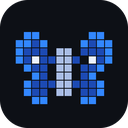
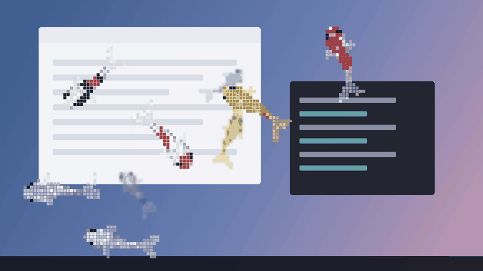
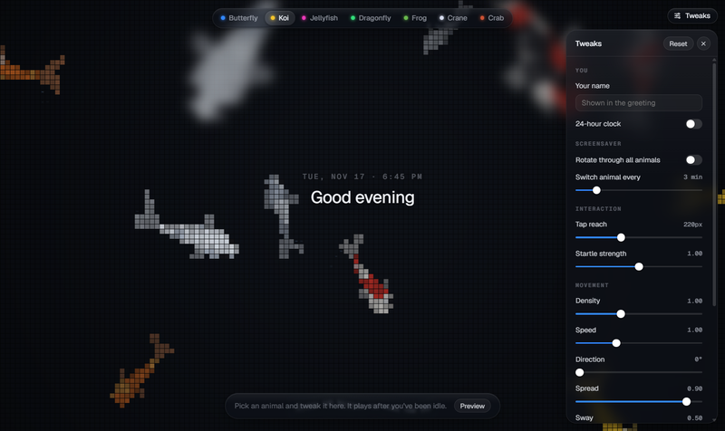
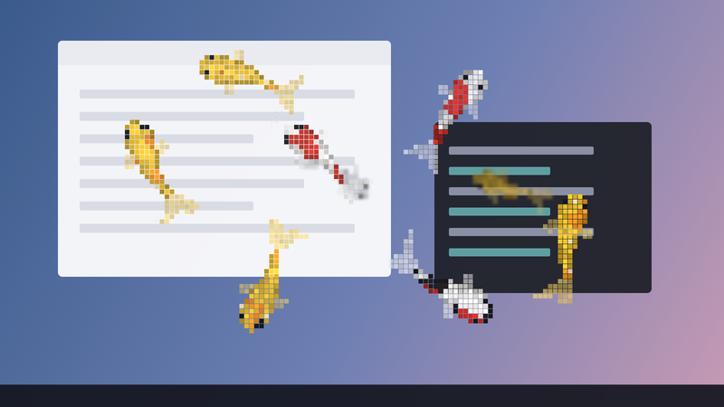
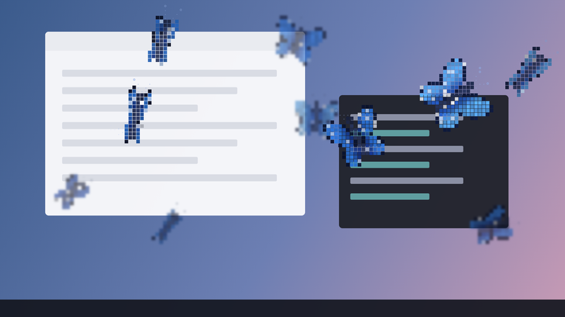
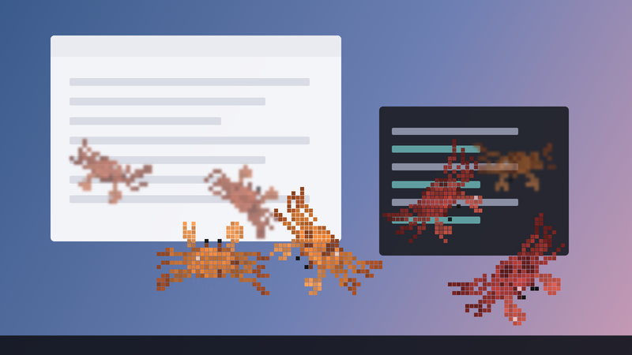
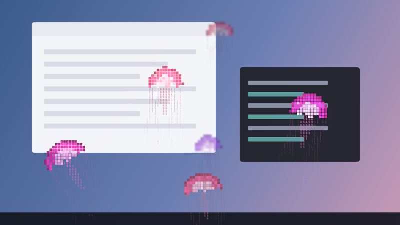
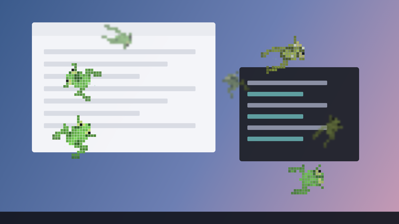
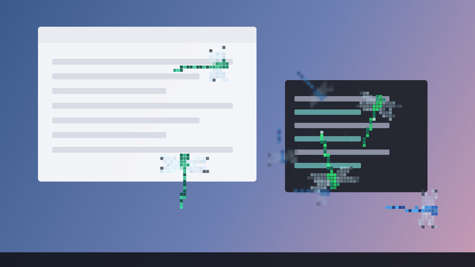

<div align="center">



# ASCII Animals Screensaver

**Pixel animals wander across your desktop when you step away.**

Like the old Windows screensavers, but calmer. Your desktop stays where you left it, and koi, crabs, butterflies and friends drift in one by one from the edges of the screen.

[](../../releases/latest)

[](../../releases/latest)
[](LICENSE)




</div>

## What it does

- **Keeps your desktop on screen.** The animals are drawn on a see-through layer over whatever you had open, with no black screen.
- **Animals arrive one at a time.** Each animal enters from the side of the screen that suits how it moves, then wanders around.
- **Has real depth.** Animals in front are sharp, the ones behind are smaller and softly blurred, and animals in the same layer never pile up on top of each other.
- **Has seven animals:** butterflies, koi, jellyfish, dragonflies, frogs, cranes and crabs. You can also have it rotate through all of them.
- **Gets out of the way.** Move the mouse or press any key and it's gone instantly.
- **Covers every monitor** at once.
- **Waits while videos or music are playing** and during full-screen games and presentations.
- **Never touches the internet.** It makes no network requests and collects no data.

## Install

1. Go to the [**latest release**](../../releases/latest) and download **`ASCII-Animals-Setup-x.y.z.exe`**.
2. Run it. It installs in a few seconds, with no admin rights needed, and opens the settings window.
3. That's it. The app starts with Windows from now on and lives in the system tray (by the clock, possibly under the **^** arrow).

> **"Windows protected your PC"?** The installer isn't code-signed yet (certificates cost money), so SmartScreen warns about it. Click **More info**, then **Run anyway**. The full source is in this repo if you'd rather build it yourself.

**To uninstall:** go to Settings → Apps → Installed apps → *ASCII Animals* → Uninstall.

## Use it

Right-click the tray icon:

| Menu item | What it does |
| --- | --- |
| **Preview now** | Shows the screensaver right away |
| **Choose animals & tweaks…** | Opens the settings window |
| **Start after** | Sets how long you're idle before it starts (1 to 30 minutes, default 2) |
| **Enabled** | Pauses it without quitting |
| **Start with Windows** | Launches it automatically when you sign in |

In the settings window, pick an animal at the top and open **Tweaks** to change speed, size, density, direction, sway and more. Turn on **Rotate through all animals** to get a different animal every few minutes.



> **Tip:** set **Start after** shorter than Windows' "turn off my screen" time (Settings → System → Power & battery → Screen and sleep). If the screen goes dark first, you'll never see the animals. On battery, Windows often turns the screen off after just 3 to 5 minutes.

## Gallery

| Koi | Butterflies |
| :---: | :---: |
|  |  |
| **Crabs** | **Jellyfish** |
|  |  |
| **Frogs** | **Dragonflies** |
|  |  |

<sub>The screenshots show the animals over a sample desktop. On your PC they appear over whatever you have open.</sub>

## FAQ

**Does it work while my laptop is asleep?**
No, and nothing can: when the laptop sleeps, the screen is off. It plays while you're idle, before Windows turns the screen off. It never stops your PC from sleeping.

**Does it use much battery?**
It only draws while it's showing. The rest of the time it's an idle tray icon that checks the idle timer every couple of seconds.

**Can I use it as a classic `.scr` screensaver?**
Yes. Open the install folder (`%LOCALAPPDATA%\Programs\ascii-animals-screensaver`) and make a copy of `ASCII Animals.exe` **in that same folder**, because it needs the files next to it. Rename the copy to `ASCII Animals.scr`, then right-click it and choose **Install**. It understands the standard `/s` (run) and `/c` (configure) switches. Most people won't need this, because the tray app does the same job.

**Will it pop up while I'm watching a video?**
No. Before starting, it checks whether any video or music is playing (anything that shows up in Windows' volume/media flyout, like a browser tab, a movie player or Spotify) and whether a full-screen game or presentation is in front. If so, it waits and checks again every 30 seconds. Pause the video and it starts as usual.

**It doesn't start when I'm idle.**
Check that **Enabled** is ticked in the tray menu, and that "Start after" is shorter than your screen-off time (see the tip above). It also waits while a video or music is playing, or a full-screen app is in front.

## Build from source

You need [Node.js](https://nodejs.org) 20 or newer.

```bash
git clone https://github.com/pratikphophaliya/ascii-animals-screensaver.git
cd ascii-animals-screensaver
npm install
npm start          # run the tray app
npm run preview    # show the screensaver right away
npm run dist       # build the installer into dist/
```

<details>
<summary>Project layout</summary>

```
main.js          tray menu, idle watcher, transparent full-screen windows, /s /c /p switches
preload.js       small bridge so the page can close itself or open a preview
app/index.html   the page; ?mode=saver is the screensaver, ?mode=settings is the settings window
app/animals.js   animals, simulation, renderer (depth layers, edge entrances, no-overlap)
app/style.css    styles for both modes
.github/workflows/release.yml   builds the installer and publishes a GitHub Release on every v* tag
```

</details>

<details>
<summary>Publishing a new release (maintainers)</summary>

1. Bump `version` in `package.json` (for example `1.0.1`) and commit.
2. Tag it and push:
   ```bash
   git tag v1.0.1
   git push origin main --tags
   ```
3. GitHub Actions builds the installer on Windows and attaches it to a new release. It shows up under [Releases](../../releases) in a few minutes.

</details>

## Credits

The animals and their animation come from **[Ascii-Animals-extension](https://github.com/Pawan-webdeveloper/Ascii-Animals-extension)** by [Pawan-webdeveloper](https://github.com/Pawan-webdeveloper), a lovely Chrome new-tab extension, used under the MIT License. This project turns it into a desktop screensaver. The desktop app adds the tray app, idle detection, the see-through overlay, edge entrances, depth layers and overlap avoidance.

Fonts: [Geist and Geist Mono](https://vercel.com/font) (SIL Open Font License, see `app/fonts/OFL.txt`).

## License

[MIT](LICENSE). Free to use, change and share. Please keep the copyright notices.
